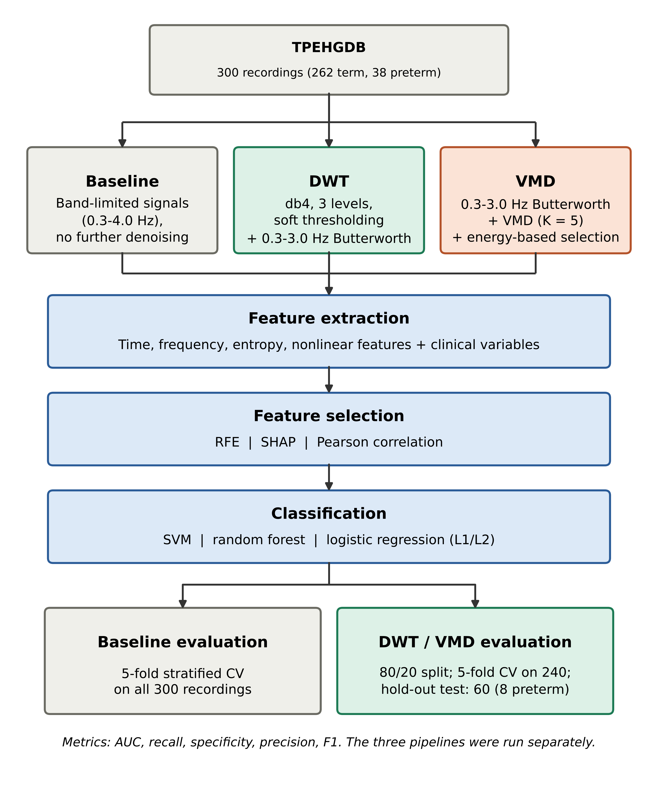
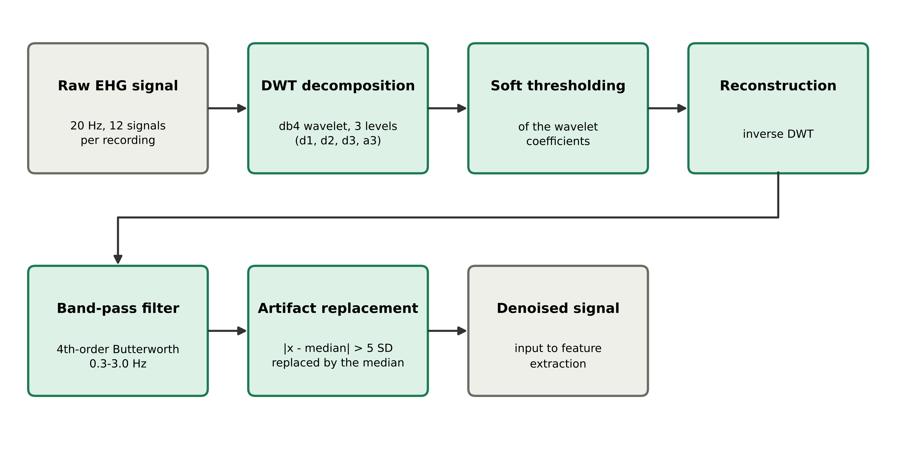
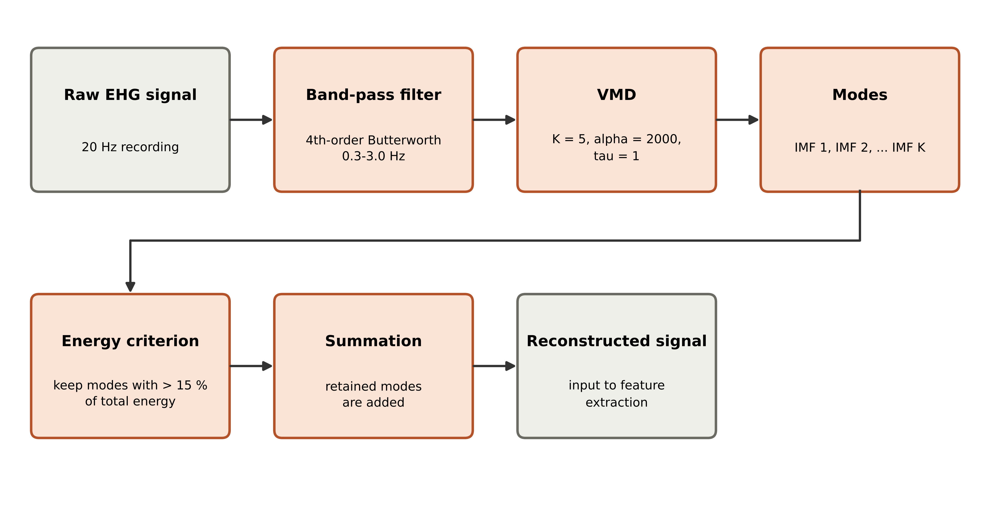
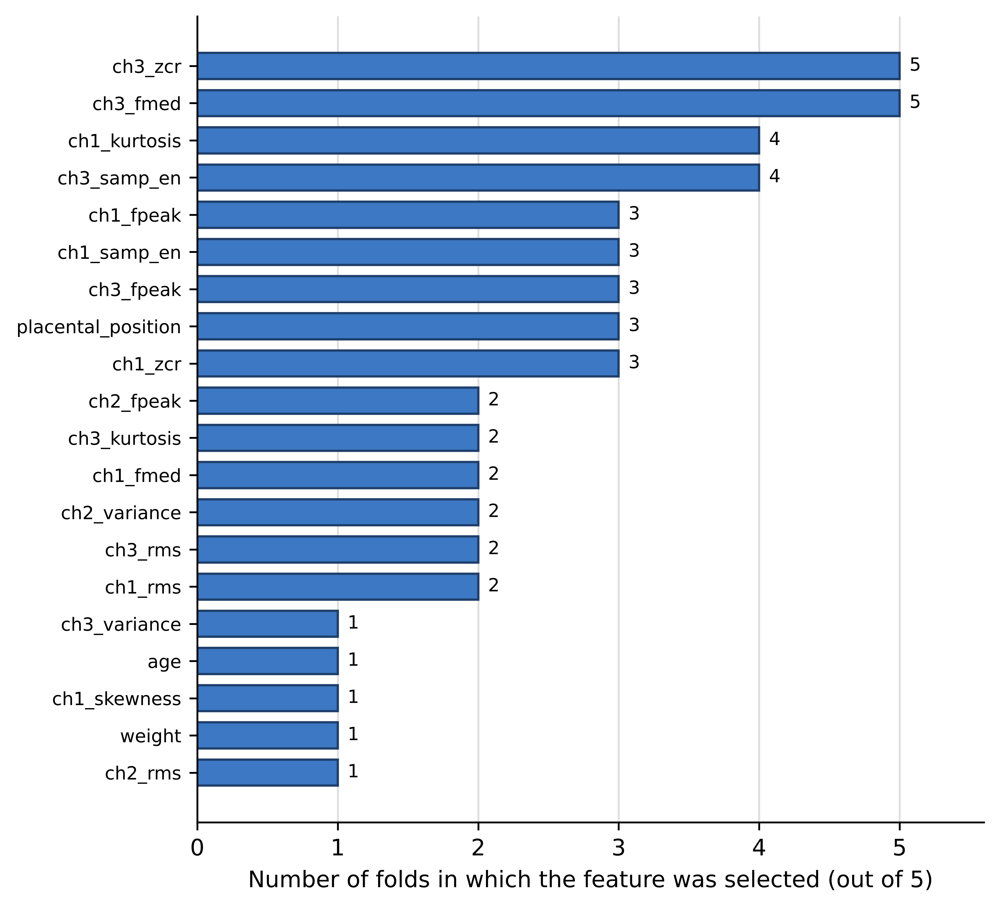
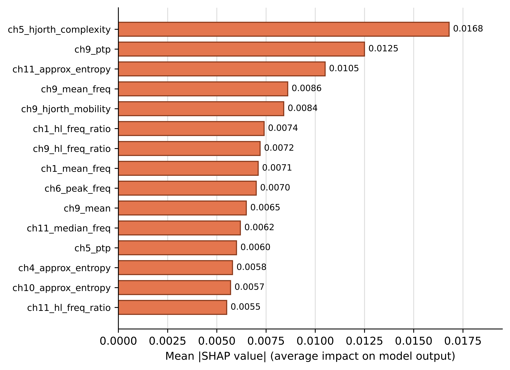
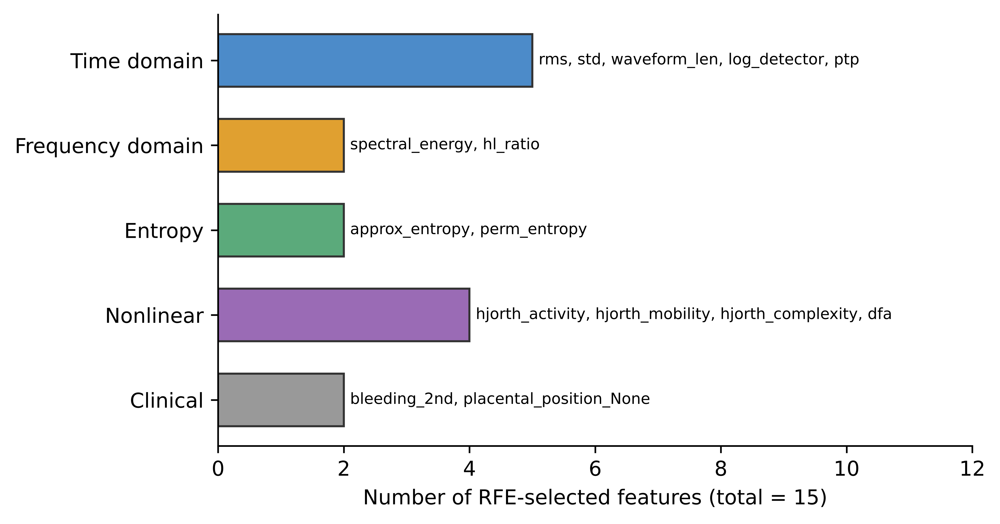

# Figures: Comparative analysis of preprocessing and feature selection for EHG-based preterm birth prediction

Dataset: Term-Preterm EHG Database (TPEHGDB v1.0.1, PhysioNet). Each figure is available as PNG (600 dpi) and as vector PDF in `figures/`.
---

## Figure 1. Overall framework

**Caption.** Overall framework of the study. TPEHGDB recordings are preprocessed with one of three strategies (baseline filtering, DWT denoising, VMD decomposition). Features from four domains and clinical variables are extracted, reduced by RFE, SHAP-based or Pearson-correlation selection, classified with SVM, random forest or logistic regression, and evaluated by AUC, recall, specificity, precision, and F1. The three pipelines were run separately and their evaluation protocols differ (Table 2). TPEHGDB, Term-Preterm Electrohysterogram Database; DWT, discrete wavelet transform; VMD, variational mode decomposition; RFE, recursive feature elimination; SHAP, SHapley Additive exPlanations; SVM, support vector machine; CV, cross-validation; AUC, area under the receiver operating characteristic curve.

---

## Figure 2. DWT-based denoising

**Caption.** DWT-based denoising of the EHG signals. Each signal is decomposed with the Daubechies-4 wavelet to three levels (detail coefficients d1 to d3, approximation a3), soft thresholding is applied to the coefficients, and the signal is reconstructed by the inverse transform. A fourth-order Butterworth band-pass filter (0.3 to 3.0 Hz) follows, and samples deviating by more than 5 standard deviations from the median are replaced by the median. EHG, electrohysterography; DWT, discrete wavelet transform; SD, standard deviation.

---

## Figure 3. VMD-based decomposition

**Caption.** VMD-based signal processing. The raw signal is band-pass filtered (fourth-order Butterworth, 0.3 to 3.0 Hz) and decomposed by VMD into K = 5 intrinsic mode functions (alpha = 2000, tau = 1). Modes carrying more than 15% of the total energy are retained and summed to reconstruct the signal that is used for feature extraction. VMD, variational mode decomposition; IMF, intrinsic mode function; K, number of modes.

---

## Figure 4. Baseline: feature selection frequency

**Caption.** Number of cross-validation folds (out of five) in which each feature was selected by SHAP-based selection with a random forest in the baseline pipeline. Feature names: ch1 to ch3, channel; zcr, zero-crossing rate; fmed, median frequency; fpeak, peak frequency; samp_en, sample entropy; rms, root mean square. EHG features were computed in the 0.3 to 4.0 Hz band. SHAP, SHapley Additive exPlanations.

---

## Figure 5. DWT: most important features

**Caption.** Top 15 features of the DWT pipeline ranked by mean absolute SHAP value (random forest surrogate model). ch1 to ch12 denote the 12 signals of each recording (three channels and their database-provided filtered versions). hjorth, Hjorth parameter; ptp, peak-to-peak amplitude; hl_freq_ratio, high-to-low frequency ratio; approx_entropy, approximate entropy; mean_freq, median_freq and peak_freq, mean, median and peak frequency. DWT, discrete wavelet transform; SHAP, SHapley Additive exPlanations.

---

## Figure 6. VMD: RFE-selected features by domain

**Caption.** Domain composition of the 15 features selected by recursive feature elimination in the VMD pipeline. Bars give the number of selected features per domain, and the feature names are shown next to each bar (computed from the VMD-reconstructed signal; std, standard deviation; waveform_len, waveform length; ptp, peak-to-peak amplitude; hl_ratio, high-to-low frequency ratio; perm_entropy, permutation entropy; dfa, detrended fluctuation analysis; bleeding_2nd, bleeding in the second trimester; placental_position_None, placental position "none"). RFE, recursive feature elimination; VMD, variational mode decomposition.

---

## Figure 7. Pairwise AUC differences

**Caption.** Pairwise differences in cross-validated AUC between the baseline, DWT, and VMD pipelines for four selector-classifier combinations (first pipeline minus second). Asterisks mark uncorrected p < 0.05 (Welch t-test on fold-level AUCs); the dagger marks the only comparison that remains below 0.05 after Holm correction across the 12 comparisons. RF, random forest; SVM, support vector machine; RFE, recursive feature elimination; SHAP, SHapley Additive exPlanations.
